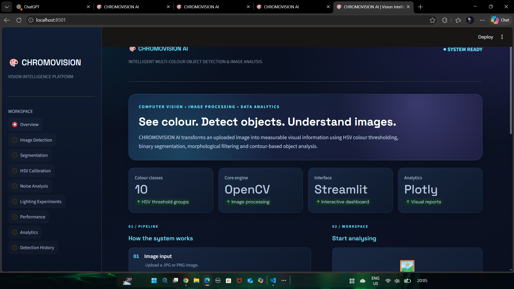
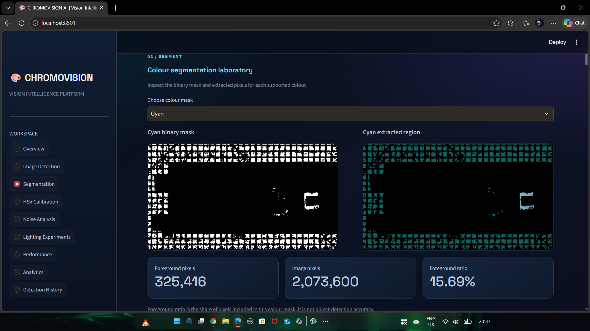

# 🎨 CHROMOVISION AI
### Intelligent Multi-Colour Object Detection and Image Analysis System

🚀 CHROMOVISION AI is a computer vision project developed using Python, OpenCV and Streamlit. The main aim of this project is to detect different colours in an uploaded image and analyse the detected regions using image processing techniques.

I developed this project to understand how colour detection, image segmentation, noise removal and contour analysis work in practical computer vision applications.

---

## 📌 About The Project

Colour detection is an important part of computer vision. It helps computers identify and separate regions based on their colour information.

In this project, I have used the **HSV (Hue, Saturation, Value) colour space** instead of relying only on RGB values. OpenCV is used to process images, apply colour thresholds, generate masks and analyse detected regions.

The application provides an interactive dashboard where users can upload images and explore different image processing experiments.

---

## ✨ Key Features

- 🎨 **Multi-Colour Detection** – Detects multiple colours in uploaded images.
- 🖼️ **Image Segmentation** – Separates selected colour regions from the original image.
- 🎛️ **HSV Calibration** – Allows users to adjust colour detection ranges.
- 🔍 **Contour Analysis** – Analyses detected regions and their properties.
- 🧹 **Noise Analysis** – Compares different image denoising techniques.
- 💡 **Lighting Experiments** – Tests how brightness and contrast variations affect detection.
- ⚡ **Performance Benchmarking** – Measures image processing time and throughput.
- 📊 **Data Analytics** – Displays detection results through interactive charts.
- 📝 **Detection History** – Maintains detection records during the current application session.

---

## 🌈 Supported Colours

The system currently supports 10 colour categories:

🔴 Red | 🟠 Orange | 🟡 Yellow | 🟢 Green | 🩵 Cyan  
🔵 Blue | 🟣 Purple | 🩷 Pink | ⚪ White | ⚫ Black

---

## 🛠️ Technologies Used

| Technology | Purpose |
|---|---|
| Python | Main programming language |
| OpenCV | Image processing and colour detection |
| NumPy | Numerical operations and image arrays |
| Pandas | Data handling and analysis |
| Streamlit | Interactive web application |
| Plotly | Interactive charts and visualisation |
| Pillow | Image handling |

---

## 🏗️ Application Modules

The application contains nine main sections:

1. 🏠 **Overview** – Introduction and system information.
2. 🖼️ **Image Detection** – Upload images and detect supported colours.
3. 🎨 **Segmentation** – View colour masks and extracted regions.
4. 🎛️ **HSV Calibration** – Experiment with HSV colour thresholds.
5. 🧹 **Noise Analysis** – Compare image denoising methods.
6. 💡 **Lighting Experiments** – Analyse detection under brightness variations.
7. ⚡ **Performance** – Evaluate processing performance.
8. 📊 **Analytics** – Explore detection statistics and charts.
9. 📜 **Detection History** – View previous detections in the current session.

---

## 📸 Application Screenshots

### 1. 🏠 Overview


### 2. 🖼️ Image Detection


### 3. 🎨 Segmentation


### 4. 🎛️ HSV Calibration


### 5. 📊 Analytics


---

## ⚙️ How It Works

The basic working process of CHROMOVISION AI:

1. The user uploads an image.
2. OpenCV reads and processes the image.
3. The image is converted from BGR to HSV colour space.
4. HSV colour thresholds are applied to identify selected colours.
5. Binary masks are generated for the detected colour regions.
6. Contour analysis is performed on the detected regions.
7. Results are displayed through images, metrics and interactive charts.

---

## 💻 Installation and Setup

Follow these steps to run the project on your local computer.

### Step 1: Clone the Repository

```bash
git clone YOUR_GITHUB_REPOSITORY_LINK
```

### Step 2: Open the Project Folder

```bash
cd CHROMOVISION-AI
```

### Step 3: Create a Virtual Environment

```bash
python -m venv venv
```

### Step 4: Activate the Environment

For Windows PowerShell:

```powershell
.\venv\Scripts\Activate.ps1
```

### Step 5: Install Required Libraries

```bash
pip install -r requirements.txt
```

### Step 6: Run the Application

```bash
streamlit run app.py
```

The application will open in your browser.

---

## 📈 Experiments and Analysis

During the development of this project, I explored different image processing concepts:

- Colour detection using HSV thresholding.
- Comparison of RGB and HSV colour spaces.
- Image segmentation using binary masks.
- Noise reduction using different filtering techniques.
- Effect of brightness and contrast on colour detection.
- Contour-based object region analysis.
- Processing time and performance measurement.

---

## ⚠️ Limitations

- Detection depends on the configured HSV colour ranges.
- Different lighting conditions can affect colour detection.
- Similar colours in the background may also be detected.
- This is a traditional computer vision project, not a trained AI object recognition model.
- Detection history is maintained during the current Streamlit session and is not stored permanently.

---

## 🔮 Future Improvements

Some features that could be added in future versions:

- 📷 Real-time webcam-based colour detection.
- 🎯 More advanced object tracking.
- 🤖 Integration with machine learning models.
- 💾 Permanent storage of detection history.
- 📱 Improved mobile-friendly interface.

---

## 🎓 Learning Outcomes

Through this project, I gained practical experience with:

- Python programming.
- OpenCV image processing.
- HSV colour space and thresholding.
- Image segmentation and contour detection.
- Data analysis and visualisation.
- Building interactive applications using Streamlit.
- Organising a modular Python project.

---

## 👨‍💻 Developed By

**Pushpendu Das**

🎓 B.Tech – Information Technology  
🏫 Haldia Institute of Technology

💻 Interested in Data Analytics, Data Science, Artificial Intelligence and Machine Learning.

---

⭐ If you find this project interesting, feel free to explore the repository!

**Thank you for checking out CHROMOVISION AI!** 🎨